<p align="center"></p>

# Claude Code practicum

14 tasks on a real little project: you work in your own terminal with the real Claude Code, and `npm run check` tells you what you got right.

The practicum continues the free course **["Claude Code: Pro Level"](https://zero2vibecode.com/learn/claude-code-pro)** on [zero2vibecode.com](https://zero2vibecode.com). There, each topic is explained and practiced in a simulator right in the browser. Here you do the same thing for real.

## What you need

- **Node.js 20 or newer.** Check with `node --version`.
- **Claude Code** — installing it and signing in are covered in [the install lesson](https://zero2vibecode.com/learn/claude-code/0-2-install-claude-code).
- **Access to Claude:** a Claude subscription (Pro or higher) or an API key. That is the only paid part — the tasks and the course are free.

No access to Claude yet? Take the course in the browser: [the simulator](https://zero2vibecode.com/learn/claude-code-pro) practices the same topics with nothing to install and nothing to pay.

## Getting started

**Fastest — in the browser.** [](https://codespaces.new/FunFactoryDev/claude-code-practicum)
You get a ready environment with Node and Claude Code already installed; nothing goes on your computer. Type `claude` and sign in to your account. The free Codespaces hours on a personal GitHub account cover the whole practicum. Note: if the environment is rebuilt, you will need to sign in to Claude Code again.

**Or on your own computer:**

1. Click **Use this template → Create a new repository** at the top of the page to get your own copy. Or just clone it:
   ```bash
   git clone https://github.com/FunFactoryDev/claude-code-practicum.git
   cd claude-code-practicum
   ```
2. Make sure everything is in place:
   ```bash
   npm test          # one test fails — on purpose, that is task 2
   npm run check     # 0 of 14 — for now
   ```
3. Start `claude` in the project folder and work through the tasks in order.

## Tasks

| # | Task | Lesson |
|---|---|---|
| 1 | [Project memory: CLAUDE.md](practice/01-claude-md.md) | [CLAUDE.md — stop repeating yourself](https://zero2vibecode.com/learn/claude-code/3-1-claude-md) |
| 2 | [Fix the failing test — plan first](practice/02-plan-fix.md) | [Permission modes and Shift+Tab](https://zero2vibecode.com/learn/claude-code-pro/1-1-permission-modes) |
| 3 | [Test first, then the fix](practice/03-test-first.md) | [/rewind: roll back a step that went wrong](https://zero2vibecode.com/learn/claude-code-pro/0-3-rewind) |
| 4 | [Allow and deny rules](practice/04-permissions.md) | [Allow and deny rules: where they live](https://zero2vibecode.com/learn/claude-code-pro/1-2-allow-deny-rules) |
| 5 | [A sandbox for commands](practice/05-sandbox.md) | [The sandbox: a boundary the system enforces](https://zero2vibecode.com/learn/claude-code-pro/1-3-sandbox) |
| 6 | [A guard hook for .env](practice/06-hook.md) | [Hooks: a rule that cannot be forgotten](https://zero2vibecode.com/learn/claude-code-pro/2-1-pretooluse-hooks) |
| 7 | [Your own skill](practice/07-skill.md) | [Skill patterns](https://zero2vibecode.com/learn/claude-code-pro/5-2-skill-patterns) |
| 8 | [A reviewer subagent](practice/08-subagent.md) | [Choosing an orchestration pattern](https://zero2vibecode.com/learn/claude-code-pro/4-2-choosing-a-pattern) |
| 9 | [An MCP server for the project](practice/09-mcp.md) | [MCP — connecting outside tools](https://zero2vibecode.com/learn/claude-code/3-3-mcp-servers) |
| 10 | [The status line](practice/10-statusline.md) | [The status line, output styles and built-in teachers](https://zero2vibecode.com/learn/claude-code-pro/2-4-status-line-and-output-styles) |
| 11 | [An unattended run with limits](practice/11-bounded-run.md) | [Unattended runs with limits](https://zero2vibecode.com/learn/claude-code-pro/3-2-bounded-unattended-runs) |
| 12 | [Claude in GitHub Actions](practice/12-github-actions.md) | [GitHub Actions: Claude in issues and pull requests](https://zero2vibecode.com/learn/claude-code-pro/3-3-github-actions) |
| 13 | [Finale: /goal and dedupeLinks](practice/13-final-goal.md) | [/goal, /loop and Agent view](https://zero2vibecode.com/learn/claude-code-pro/3-4-goal-loop-agent-view) |
| 14 | [The full cycle: from request to commit](practice/14-full-cycle.md) | [From request to commit](https://zero2vibecode.com/learn/claude-code-pro/5-4-request-to-commit) |

Check one task, with a hint and a link to its lesson: `npm run check -- 6`.

Once all 14 pass, the check prints a **completion code** like `CCP-XXXX-XXXX`. Enter it on the [course page](https://zero2vibecode.com/learn/claude-code-pro) to get the "Claude Code Practitioner" badge.

## The project

`src/links.js` is a utility for links in Markdown: find them, bring them to one form, drop duplicates. `src/cli.js` prints the links from a file: `npm run links`. The code has two bugs and one unwritten function — those are tasks 2, 3 and 13; in task 14 you add a new feature, from plan to commit.

## Safety

You are about to run Claude Code in a repository written by someone else, so it is right to look at what is in it first.

- **No dependencies.** No `npm install` needed: not a single package from the internet.
- **No hooks, MCP servers or Claude settings** — there is no `.claude/` folder here. You will create all of that yourself, task by task.
- **`.devcontainer/devcontainer.json`** is only for Codespaces: it installs Node, Anthropic's official Claude Code feature, and `bubblewrap` with `socat` for the sandbox. On your computer it runs nothing.
- Only what you can see runs: `npm test` (Node's test runner), `npm run check` ([check/run.mjs](check/run.mjs)) and `npm run links`. The check reads project files and your `~/.claude/settings.json` (task 10), changes nothing and makes no network calls.

A habit worth taking away: before you run Claude Code in someone else's repository, look at its `.claude/settings.json`, `.mcp.json` and `.claude/hooks/`.

## Found an outdated lesson?

Claude Code changes fast. If a task or a lesson no longer matches what you see, [open an "Outdated lesson" issue](https://github.com/FunFactoryDev/claude-code-practicum/issues/new?template=outdated-lesson.yml).

## Authors

The practicum is made by [FunFactoryDev](https://github.com/FunFactoryDev). There is also [a Russian version](https://github.com/FunFactoryDev/claude-code-praktikum).

## License

[MIT](LICENSE). The course and the simulator are at [zero2vibecode.com](https://zero2vibecode.com).
